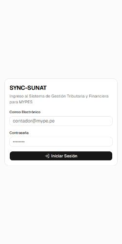
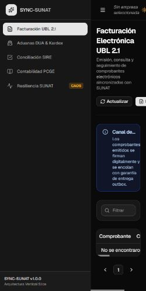
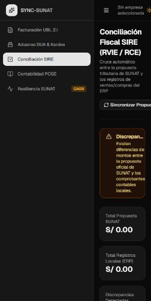

# Evidencia Lighthouse en entorno local

Auditoría ejecutada sobre la compilación de producción local (`npm run build` y `npm run preview`), con Lighthouse 13.5.0 y Chrome headless. Las dos rutas de negocio se abrieron con una sesión de prueba local. No se midió un sitio publicado.

| Pantalla | URL auditada | Accesibilidad | Performance |
|---|---|---:|---:|
| Inicio de sesión | `http://127.0.0.1:4173/login` | 100 | 95 |
| Facturación | `http://127.0.0.1:4173/invoices` | 100 | 90 |
| Conciliación SIRE | `http://127.0.0.1:4173/sire` | 100 | 91 |

## Capturas







## Reproducción

```powershell
npm ci
npm run build
npm run preview -- --host 127.0.0.1
npx lighthouse http://127.0.0.1:4173/login --only-categories=accessibility,performance
```

Para auditar rutas protegidas, usar una sesión de prueba local y navegar a `/invoices` y `/sire`. Estas puntuaciones son evidencia local de las tres pantallas auditadas; la aceptación de un requisito que solicite específicamente URL desplegada debe medirse además sobre esa URL.
